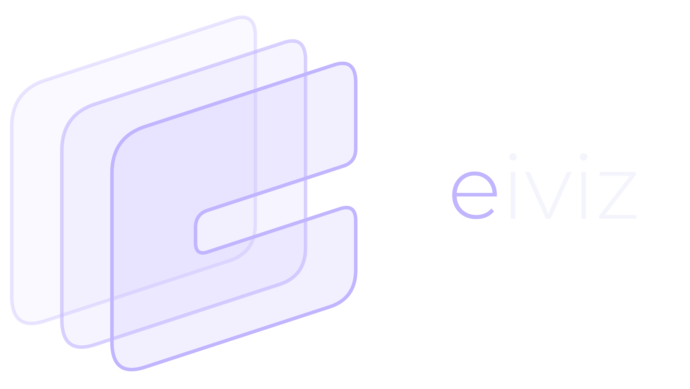

# eiviz

**現在鋭意開発中です。安定していな部分や未実装の機能が数多く存在します。ご理解ください**

## eiviz

次世代のプロダクション向けグラフィックオペレーションツール・映像スイッチャーソフトウェアです。  
PCの性能が許す限り無限にM/Eを追加可能で、既存のソフトウェアスイッチャーを凌駕する圧倒的な自由度を提供します。  

最新のモダンな技術アーキテクチャを採用することにより、既存のツールやソフトウェアでは実現が難しかった機能やクロスプラットフォーム対応を実現し、高い機能性と拡張性を提供しています。  
また、既存のソフトウェアスイッチャーの扱いづらさや反省を基に、より扱いやすく、アマチュア配信からプロの現場まで幅広く活躍できるソフトウェアとしてデザインされています。

[ドキュメント](https://mikanseilaboratory.github.io/eiviz/ja/) · [English](README.md)

| 環境 | 描画API | Supported | Tested |
| --- | --- | --- | --- | 
| Windows x64 | Direct3D 12 or Vulkan | ✅ | ✅ |
| Windows Arm | Direct3D 12 or Vulkan | ❌ | ❌ |
| macOS | Metal | ✅ | ✅ |
| Linux | Vulkan | CLIのみ | ❌ | ❌ |

`eiviz-headless`はWindows/macOS/Linuxで利用できます。

## インストール

[最新版ダウンロード](https://github.com/MikanseiLaboratory/eiviz/releases/latest) · [過去のバージョン](https://github.com/MikanseiLaboratory/eiviz/releases)

### Windows x64

`eiviz-*-win-x64-setup.exe`を実行します。

### macOS Apple Silicon（`macos-arm64`）

`eiviz-*-macos-arm64.pkg`を実行します。

### Linux 

現在CLI(headless)モードのみ対応しています。ソースコードをビルドし、`eiviz-headless`を実行してください。手順は[headless](https://mikanseilaboratory.github.io/eiviz/ja/features/headless/)を参照ください。

## 開発のAI利用について

本ツールは開発にAI/LLMを使用しています。
AIが開発を主導したVibe codingなアプリケーションではなく、開発の要所・必要なタスクの支援にツールとして活用しており、ソフトウェア本体のアーキテクチャや実装はコアメンテナが責任を持って行い、実装コードもメンテナがレビューを通過したもののみ採用しています。

## ライセンス

[PolyForm Shield License 1.0.0](LICENSE)です。営利利用・社内利用を含め制限無く利用が可能です。

有償・無償を問わず、eivizの競合となる映像スイッチャーを開発・販売を禁止します。河村柊吾/未完成成果物研究所がこのソースコードを利用して出している他の製品についても同じ条件が適用されます。競合製品を出したい場合は、別途ライセンス契約が必要です。詳細はお問い合わせください。

同梱の第三者ライブラリは、それぞれのMIT、Apache-2.0、Zlibのままです。[NOTICE](NOTICE)と[THIRD_PARTY_NOTICES.md](THIRD_PARTY_NOTICES.md)を見てください。

### クレジット

ロゴ: Guleruun (https://x.com/guleruun)
