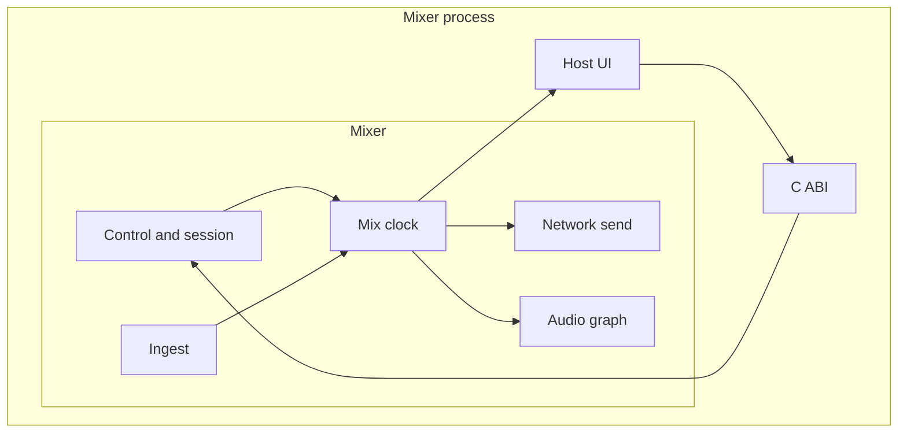
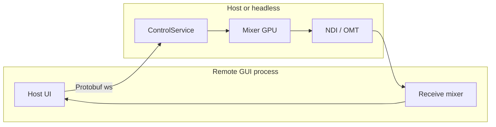
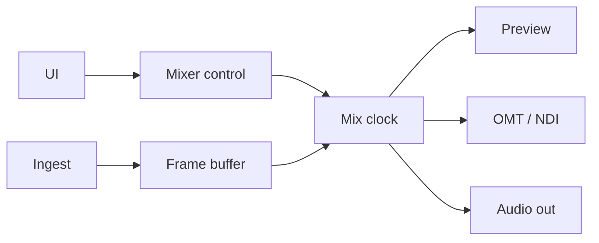
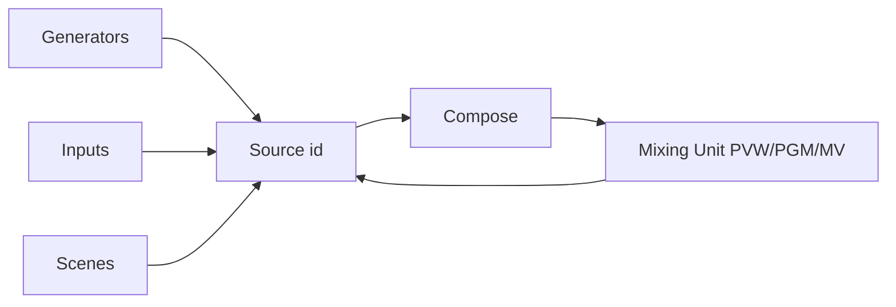
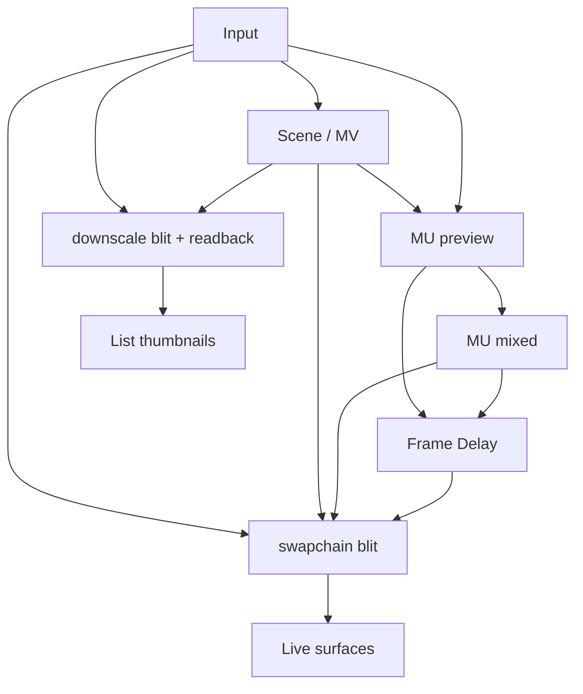
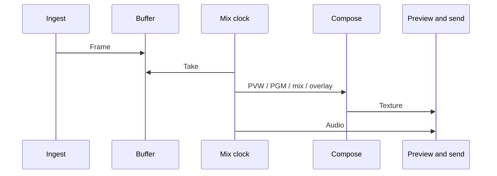
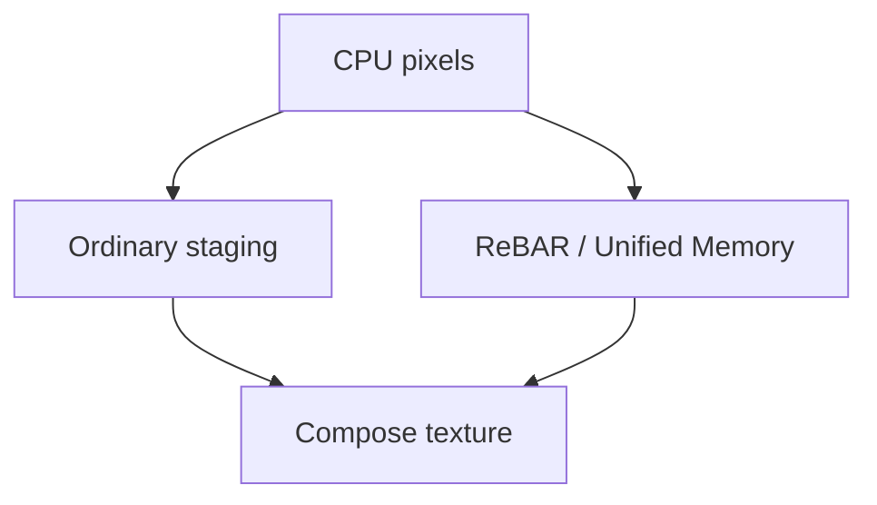

eiviz system architecture. The shape is largely the same across platforms.

## Shape

eiviz compositing runs as one mixer process.  
The video and audio state machine is the mixer (Rust + wgpu). Each OS host talks to it over an internal C ABI. Host code lives in `hosts/win32` (WPF), `hosts/macos` (SwiftUI), and `hosts/linux` (in development).

The host owns windows, interaction, and preview surfaces.  
Compose, audio, I/O, and session data live in the mixer. Keeping that work off the UI is how the stack stays fast and portable.

External control is handled by `ControlService` inside the mixer. vMix-compatible HTTP (default 8088), vMix-compatible TCP (8099), and Protobuf WebSocket (default 9400) all enter the same dispatcher. The C ABI is the host↔mixer FFI, not a public API. API listen (bind, token, media directory) is host-owned; it is not stored in the session file.

Windows and macOS also ship a [remote connection](/eiviz/en/features/remote/) client (`Eiviz.Remote.exe` / `eiviz-remote.app`). The client loads a receive mixer and `eiviz_remote`, and sends ops to the destination `ControlService`. See [eiviz API](/eiviz/en/developers/api/) for the protocol. The mixer without a host UI is [Headless](/eiviz/en/features/headless/).

## Who owns what

| | Mixer | Host |
| --- | --- | --- |
| Compose and transitions | Yes | Sends the gesture |
| GPU and audio devices | Yes | Passes settings |
| Live preview | Draws into a native surface | Supplies the surface (HWND / NSView) |
| Scene tiles and similar | Reads back from the GPU | Shows the thumbnail |

There is one mixer per process. The host never receives GPU pointers except live preview surfaces. Inputs, scenes, and Mixing Units are integer ids.

The remote-connection process shape is in the diagram above. Operator steps are in [Remote connection](/eiviz/en/features/remote/).

## Concurrency

The UI thread drives interaction and picture present.  
File, UVC, NDI, and OMT ingest fill buffers on other paths. The mixer takes frames on a fixed interval.

If processing falls behind, compose is skipped and audio still advances so the clock can catch up.  
Video keeps a few frames of buffer so it lines up with audio.

## How sources are named

Generators such as solid colour and colour bars, session inputs, composited scenes, and a Mixing Unit’s Preview / Program / Multiview all live in one **source-id space**.  
That is why one Mixing Unit’s Program can feed another Mixing Unit.

## Textures

Inputs, scenes, a Mixing Unit’s Preview/Program, and Multiview all live in one source-id space as **GPU textures**. Compose and the GUI sample those `TextureView`s.

| Kind | What it is |
| --- | --- |
| Input | Ingest result. GPU ingest shares the handle; CPU ingest overwrites one texture |
| Scene | Composited layers |
| Multiview | The same scene object, plus labels and tallies |
| Preview | The Mixing Unit `preview` bus |
| Program | `mixed` after mix and overlays. GUI and send point here |

Program keeps a pre-mix `program` target and the on-air `mixed` target. Compose draws live scenes. Session scene textures stay allocated.

### Path to the GUI

The host supplies the window surface; the mixer draws into it. There are two paths.

Live Preview/Program, an open Multiview, Scene Editor, and the Overlay window blit an existing view into an HWND / NSView swapchain. Several live surfaces of the same source each blit that view.

Input lists, scene lists, and switcher source buttons read back a downscale (up to 960×540).

### GPU copies

These copies run in the frame:

- Frame Delay. Copies `mixed` and `preview` into a ring so picture lines up with audio. GUI Preview/Program sample that delayed surface
- Transition history. Copies `mixed` into `prev`
- Send. If CPU encode is selected, the frame is read back as UYVY, then converted to the VMX codec and sent on a dedicated CPU send thread. GPU OMT copies into a per-output send slot

Intermediate buffers such as sort / flow / bloom stay in VRAM. Their compute runs during those transitions.

## One frame

A frame has three lanes:

1. On-air ingest — every master frame
2. On-air compose (Preview/Program/outputs) — every master frame
3. Monitor compose (scene tiles, input preview) and ingest for those sources — present interval

On-air sources upload every master frame. Monitor and thumbnail Inputs upload on their present interval. OMT receive quality reads every attached monitor and thumb each tick.

Then the picture moves like this:

1. An ingest thread deposits the latest frame
2. Each Mixing Unit draws Preview and Program, mixes with the T-bar or AUTO, then overlays and multiview
3. Outputs that send pack UYVY or copy into a GPU slot
4. One thread is assigned per output to compress and transmit
5. Audio buses mix on the same master tick and ride those outputs. When Multiview is selected as the video source, audio cannot be sent

## Hardware acceleration by stage

The mixer keeps one GPU frame type and one upload/ingest contract across platforms; only
the platform import step differs. The selected profile is logged at startup as
`accel ...`, so a performance report can name the actual path.

| Stage | Windows | macOS | Linux |
|---|---|---|---|
| File / UVC decode | Media Foundation with hardware transforms and a D3D manager | AVFoundation / VideoToolbox into `CVMetalTextureCache` | Vulkan Video |
| Frame upload | ReBAR or Vulkan host-visible ring | Unified-memory shared `MTLTexture` ring | Vulkan staging/host-visible |
| NDI ingest | ReBAR / Vulkan ingest ring | Unified-memory ring with frame leases | Vulkan ingest ring |
| MP4 export | Media Foundation hardware H.264/HEVC | AVAssetWriter / VideoToolbox H.264/HEVC | Not available |
| Live RTMP video | OpenH264 (software) | OpenH264 (software) | OpenH264 (software) |
| Replay encode | VMX1 CPU encoder; GPU ring copies pixels | VMX1 CPU encoder; GPU ring copies pixels | VMX1 CPU encoder |
| DeckLink I/O | Pro module + hardware | Not supported | Pro module + hardware |

macOS is not using a software decode path where Windows uses hardware: decode is
VideoToolbox and the decoded surface is imported into Metal without a CPU copy. MP4 export
also uses the platform media engine. The two software stages — live RTMP and Replay — are
software on every platform, so macOS does not lose parity there. The main macOS
performance trade-off is GPU throughput versus a large discrete Windows GPU, not an
architectural copy or decode penalty.

The natural next commonization is a `VideoEncoder` interface with zero-cost enum
backends (`VideoToolbox`, Media Foundation, OpenH264). It would let live RTMP use the
platform encoder without forking the RTMP muxer. It is not enabled yet: the current RTMP
contract is OpenH264 on every OS, and the Replay container uses the VMX1 codec rather than
H.264.

### Measured baseline (M3 MacBook Air)

A headless Metal session was measured on a 16 GB M3 MacBook Air. It held four 1080p59.94
Mixing Units, a nine-pane multiview, a 4K still, a 1080p file, the built-in camera, and two
network outputs. The `eiviz stats` line reports `render_ms`, the frame budget, RSS/VRAM, and
`surface_lost` every five seconds.

| Scenario | Process CPU | `render_ms` | Notes |
|---|---|---|---|
| Four units + multiview + still | ~22 % | 1.3–1.7 ms | 1.0 GB RSS, 654 MB VRAM |
| Add file + camera | ~47 % | 1.3–1.9 ms | AVFoundation conversion/decode |
| Add OMT + NDI outputs | ~130 % during switching | 1.3–2.9 ms | NDI's CPU SpeedHQ encode dominates |
| Outputs disabled | ~45 % | 1.3–2.0 ms | same video/camera load |

The frame budget at 59.94 Hz is 16.68 ms, so composition itself keeps roughly a 6–12×
margin. `surface_lost` stayed zero and no frame deadline was missed. RSS stayed near 1.35 GB
and VRAM near 682 MB with four units. The largest cost is the NDI SDK's software encoder;
it is CPU on every platform. OMT can skip encode when no receiver is subscribed. The second
cost is AVFoundation's BGRA conversion for file/camera frames, visible as
`videomediaconverter` threads; requesting NV12 and converting on the GPU is the next
candidate, but it would add a second shader path and is not enabled.

The ARM64 `yuv422_to_bgra` kernel was scalar; a NEON version now converts 1080p in
1.51 ms instead of 5.21 ms (about 3.5× faster) on the same M3. That kernel is used where
YUV 4:2:2 is converted on the CPU; the macOS AVFoundation path itself already avoids the
conversion by importing the decoded Metal texture.

These numbers are one machine and one preset, not a Windows comparison. The headless
session and commands are reproducible through `eivizctl`; the stats line is emitted by
`eiviz-headless` in both normal and soak runs.

## GPU

Compose calls the GPU through a wgpu abstraction. Windows is Direct3D 12; macOS is Metal.  
CPU pictures usually upload through system memory.

On Windows with Resizable BAR on a discrete GPU, the host reaches through wgpu to the DX12 low-level API and writes straight into VRAM.  
Apple Silicon uses unified memory for a similar path.

File and UVC decode on macOS uses `CVMetalTextureCache` and hands the decoded
`CVPixelBuffer` to Metal without a CPU copy. The texture is imported through the Metal
HAL and released with the wgpu texture. NDI ingest uses the same unified-memory
approach with a leased shared-texture ring.  
GPU upload can be changed in [Settings](/eiviz/en/introduction/settings/).

## Audio

The internal mix is a 48 kHz graph. Every Mixing Unit has one MU Bus. Headphone plays the Mixing Unit or Input chosen with the meter icon.  
Inputs route to a set of Mixing Units and have gain. Follow tracks Preview/Program. Overlays can follow too.

Detail is in [MU Bus](/eiviz/en/concepts/audio-auxs/).

## Outputs

| | Video | Status |
| --- | --- | --- |
| OMT | Stay on the GPU, or read back as UYVY and convert to VMX on a dedicated send thread | Shipped |
| NDI | CPU path | Shipped |
| DeckLink | Pro module, UYVY or Fill/Key RGBA | Pro |

One thread is assigned per output.

OMT receive stays full quality on Preview/Program and drops bandwidth otherwise.  
Full quality holds a short time after leaving those buses so TAKE and the T-bar do not rebuild the receiver.

Detail is in [Settings](/eiviz/en/introduction/settings/) → Outputs and [NDI / OMT](/eiviz/en/features/outputs/ndi-omt/).

## Hosts

Per-OS hosts live in `hosts/win32`, `hosts/macos`, and `hosts/linux`. Live Preview/Program, an open Multiview, Scene Editor, the Overlay window, and a switcher’s Preview/Program are drawn by the mixer into a native surface. Windows uses a child HWND; macOS uses an NSView with a Metal layer from wgpu.

On a remote connection those live surfaces sample NDI/OMT receivers. Operator steps are in [Remote connection](/eiviz/en/features/remote/). A Mix Input is a delayed alias of a Mixing Unit bus or a session Multiview; it reads the FrameDelay ring and uses the same thumbnail path.

Under DirectX 12 on Windows, the number of simultaneous active DXGI flip model swapchains is constrained. **Video output destination window limit** under [Settings](/eiviz/en/introduction/settings/) caps the number of active preview surfaces. Real-time Preview, Program, and Multiview windows draw into these surfaces (a Switcher UI requires 2 slots for Preview and Program). You can increase this limit, though doing so may reduce stability. Closing a window detaches its swapchain and frees the slot. Closing the main window closes secondary windows and exits the process (blocked while On Air Lock is active).

Reloading a session rebuilds the main window so preview surfaces attach on first layout. HWNDs are not reused across mixer lifetimes.

## Pro module

DeckLink I/O, RTMP streaming, and paid-plan entitlements are provided by a signed Pro module. The mixer loads this module once at startup through a versioned C ABI and keeps it mapped until the process terminates. A public build without this module operates under Community limits. An official package containing `eiviz-pro.required` fails startup if the module is missing, corrupted, or built for an incompatible ABI; it does not fall back to Community.

Calls not permitted under the active plan return `ERR_NOT_SUPPORTED_PLAN`; unlinked implementations return `ERR_IO` (plan validation takes precedence). Host UIs dynamically expose DeckLink and RTMP options based on runtime `mixer_capabilities` rather than compile-time feature flags.

Paid plans are authenticated using cryptographically signed license tickets. The Pro module embeds the Ed25519 public key, evaluates expiration against the later of the system clock and a persisted timestamp, and authenticates the machine if a majority of salted hardware fingerprints match. The host UI is solely responsible for installing tickets and displaying status, containing no entitlement decision logic. Plan limits are detailed in [Plans](/eiviz/en/introduction/plans/).
