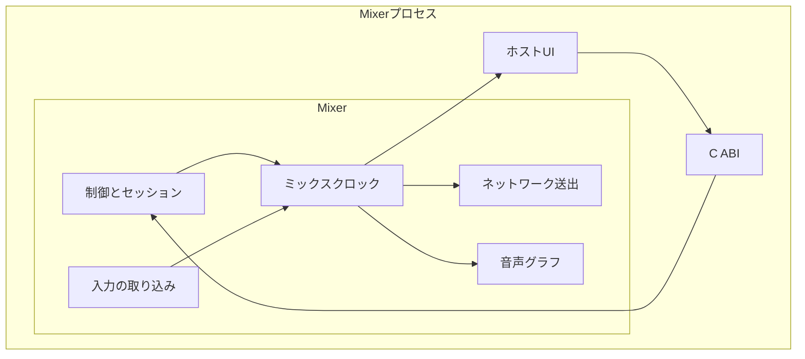
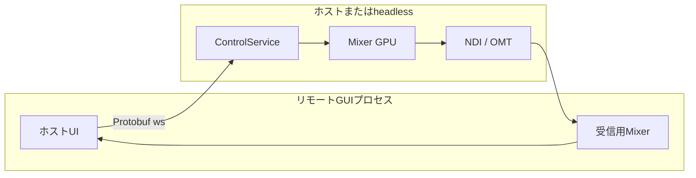
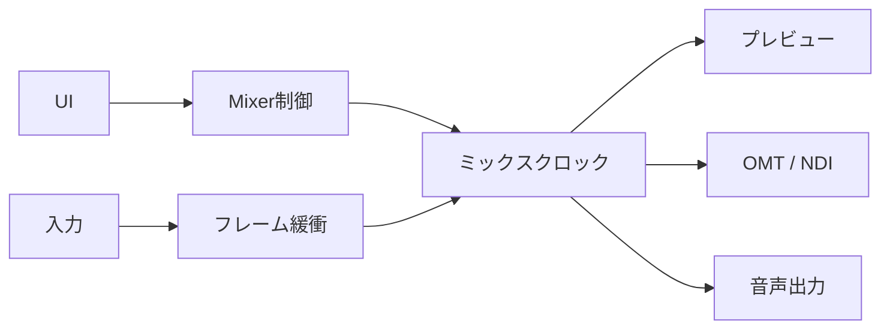
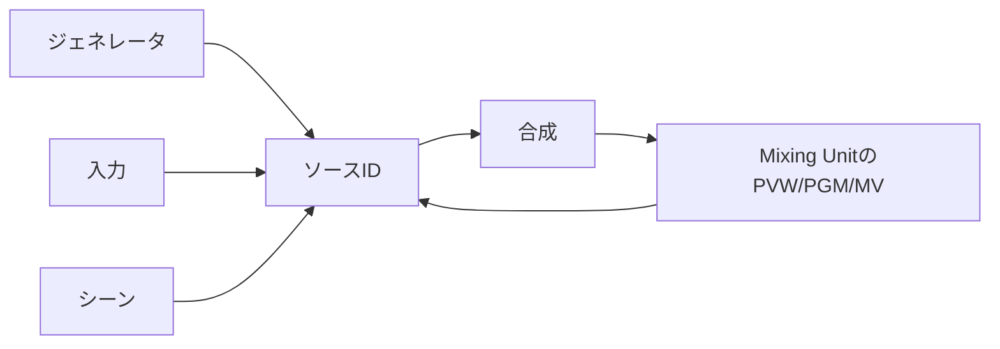
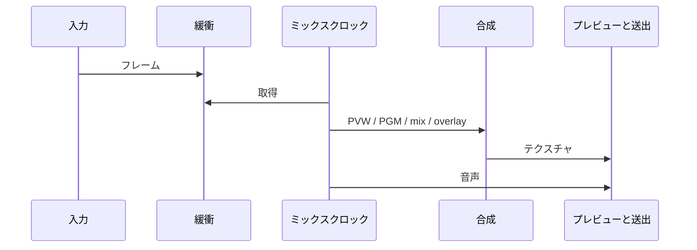

eivizの全体設計と処理の流れについて解説します。

## 全体像

eivizは、映像・音声合成を担うバックエンド「Mixer」と、各OS向けのフロントエンド「ホストUI」を明確に分離した設計を採用しています。

- **Mixer（Rust + wgpu）**: 映像合成、音声ミックス、入力取り込み、ネットワーク送出、セッション管理を担います。
- **ホストUI**: 操作インターフェースの提供やプレビュー描画領域の確保を行い、内部のC ABIを通じてMixerと通信します。

外部からの制御（vMix互換HTTP/TCP、Protobuf WebSocket）はMixer内の`ControlService`が一元的に受け付け、ディスパッチャを経由して処理されます。

リモート接続時は、クライアント側の`Eiviz.Remote`がWebSocketで接続先ホストの`ControlService`にコマンドを送り、映像はNDIまたはOMT経由で受信します。

## 責務の分離

| 領域 | Mixer | ホストUI |
| --- | --- | --- |
| 映像合成・トランジション | 実行 | 操作要求を発行 |
| デバイス制御（GPU/音声） | 管理・入出力 | 設定値を渡す |
| リアルタイムプレビュー | ネイティブサーフェスへ描画 | ウィンドウハンドル（HWND/NSView）を提供 |
| サムネイル・シーン一覧 | GPUから縮小読み戻し | UIへの表示 |

MixerとUIの間では、リアルタイム描画用のサーフェスを除いてGPUポインタの直接受け渡しは行わず、リソースは整数IDで管理されます。

## 並行処理とクロック同期

UIスレッド、映像入力スレッド、音声処理、ネットワーク送出はそれぞれ独立したスレッドで動作します。

- 映像入力は各ソース専用のスレッドでバッファに蓄積され、マスタークロックの周期でMixerへ供給されます。
- 処理遅延が発生した場合は映像合成をスキップし、音声クロックを優先することでリアルタイム性を保ちます。
- 映像と音声の同期はフレームバッファ（既定3フレーム）によって維持されます。

## ソース管理とGPUテクスチャ

単色ジェネレータ、カメラ入力、動画ファイル、Sceneの合成結果、Mixing UnitのPreview/Program出力は、すべて同一の**ソースID空間**で管理されます。これにより、あるMixing Unitの出力を別のMixing Unitの入力レイヤーとして再帰的に利用できます。

内部的には各ソースがGPUテクスチャ（`TextureView`）として保持されており、合成エンジンやGUIプレビューはそれらをサンプリングして描画します。

## 1フレームの処理フロー

マスターフレームの1サイクルは以下の流れで進行します。

1. **入力取り込み**: 各入力スレッドが最新フレームを確定。
2. **映像合成**: Mixing UnitごとにPreviewとProgramを描画し、トランジションやOverlay、Multiviewを合成。
3. **送出準備**: 出力設定に応じてGPUスロットへのコピー、またはUYVY形式でのCPU読み出しを実行。
4. **エンコードと送信**: 出力先ごとに割り当てられたスレッドが圧縮とネットワーク送信を実行。
5. **音声処理**: 同一のタイムスタンプで音声バスをミックスし、各出力へ送出。

## 段階ごとのハードウェアアクセラレーション

GPUフレーム型とアップロード／取り込みの契約は全プラットフォームで共通で、異なるのは
プラットフォーム固有のimport処理だけです。起動時に`accel ...`として選択中の経路を
ログへ出すため、性能報告では実際の経路を特定できます。

| 段階 | Windows | macOS | Linux |
|---|---|---|---|
| ファイル／UVCデコード | Media Foundation（ハードウェアトランスフォーム、D3Dマネージャー） | AVFoundation／VideoToolboxから`CVMetalTextureCache`へ | Vulkan Video |
| フレームアップロード | ReBARまたはVulkan host-visible ring | Unified Memoryの共有`MTLTexture` ring | Vulkan staging／host-visible |
| NDI取り込み | ReBAR／Vulkan ingest ring | lease付きUnified Memory ring | Vulkan ingest ring |
| MP4書き出し | Media FoundationのハードウェアH.264/HEVC | AVAssetWriter／VideoToolboxのH.264/HEVC | 非対応 |
| RTMPライブ映像 | OpenH264（ソフトウェア） | VideoToolbox H.264（OpenH264フォールバック） | OpenH264（ソフトウェア） |
| Replayエンコード | VMX1 CPUエンコーダー。GPU ringは画素コピー | VMX1 CPUエンコーダー。GPU ringは画素コピー | VMX1 CPUエンコーダー |
| DeckLink入出力 | Proモジュール＋ハードウェア | 非対応 | Proモジュール＋ハードウェア |

macOSはWindowsがハードウェアデコードを使う場面でソフトウェアデコードに落ちている
わけではありません。デコードはVideoToolboxで、デコード済みサーフェスをCPUコピー
なしでMetalへimportします。MP4書き出しもプラットフォームのメディアエンジンを使います。
macOSのRTMPライブはVideoToolbox H.264を使い、ハードウェアエンコードが使えない場合だけOpenH264へフォールバックします。Replayは引き続き全OSでソフトウェアです。
macOSの主な性能トレードオフは、大きなWindowsディスクリートGPUに対するGPUスループットで
あり、コピーやデコード経路のアーキテクチャ上の不利ではありません。

次の共通化候補は、ゼロコストのenumバックエンド（`VideoToolbox`、Media Foundation、
OpenH264）を持つ`VideoEncoder`インターフェースです。RTMPマルチプレクサを分岐せずに
プラットフォームエンコーダーを使えるようになります。ただし現行のRTMP契約は全OSで
OpenH264、ReplayコンテナはH.264ではなくVMX1のため、まだ有効化していません。

### M3 MacBook Airでの実測

16GB M3 MacBook AirのMetalヘッドレスセッションで、1080p59.94のMixing Unit 4台、9ペイン
Multiview、4Kスチル、1080pファイル、内蔵カメラ、ネットワーク出力2系統を動かしました。
`eiviz stats`は5秒ごとに`render_ms`、フレーム予算、RSS/VRAM、`surface_lost`を出します。

| シナリオ | プロセスCPU | `render_ms` | 備考 |
|---|---|---|---|
| Unit 4台＋Multiview＋スチル | 約22% | 1.3〜1.7ms | RSS 1.0GB、VRAM 654MB |
| ファイル＋カメラを追加 | 約31% | 1.3〜1.9ms | NV12デコード＋VideoToolbox変換 |
| OMT＋NDI出力を追加 | スイッチング中 約130% | 1.3〜2.9ms | NDIのCPU SpeedHQエンコードが支配的 |
| 出力を無効化 | 約45% | 1.3〜2.0ms | 同じファイル／カメラ負荷 |

59.94Hzの予算は16.68msなので、合成そのものには6〜12倍の余裕があります。`surface_lost`は
0のままで、フレーム期限の未達もありませんでした。Unit 4台でRSSは約1.35GB、VRAMは約682MB
でした。最大のコストはNDI SDKのソフトウェアエンコーダーで、これは全OSでCPUです。OMTは
受信者がいないときエンコードを省略できます。ファイル／カメラはNV12で受け取り、`VTPixelTransferSession`でBGRAへ変換してから
zero-copyでMetalへimportする。これによりAVFoundationのBGRA変換がCPUパスから外れ、
ファイル＋カメラのケースは約47%から31%へ下がりました。

ARM64の`yuv422_to_bgra`はスカラー実装でしたが、NEON版で1080pが5.21msから1.51msへ
約3.5倍高速化しました。このカーネルはCPUでYUV 4:2:2を変換する経路で使われ、macOSの
AVFoundation経路はNV12＋VideoToolbox変換を使います。

この数値は1台・1プリセットの実測で、Windowsとの直接比較ではありません。ヘッドレス
セッションと`eivizctl`の操作で再現でき、`eiviz stats`は通常実行でもソーク実行でも出ます。

## GPU最適化

映像パイプラインはwgpuをベースとしつつ、プラットフォーム固有の高速化を行っています。

- **Windows**: Direct3D 12を使用。Resizable BAR（ReBAR）対応環境ではCPUからVRAMへ直接書き込みを行うことで、システムメモリ経由のコピーを削減します。
- **macOS**: Metalを使用。Apple Silicon環境ではUnified Memoryを活かし、共有メモリ領域経由で効率的な転送を行います。
- ファイル再生やUVC入力は`CVMetalTextureCache`を使い、デコード済みの`CVPixelBuffer`をCPUコピーなしでMetalテクスチャへ渡します。NDI取り込みもlease付き共有テクスチャ環で同じUnified Memory経路を使います。

## 音声パイプライン

内部では48 kHzステレオのオーディオグラフを処理します。各Mixing Unitが専用のMU Busを1本持ちます。ヘッドホンは、メーターのヘッドホンアイコンで選択したMixing UnitまたはInputの音声を出力します。Inputは送り先のMixing Unitとゲインの設定を持ち、FollowではPreview/Programの切り替えに連動します。Overlayの音声も連動可能です。詳細は[MU Bus](/eiviz/ja/concepts/audio-auxs/)を参照してください。

## Proモジュール

DeckLink入出力やRTMP配信、有料プランに応じた上限制御は署名済みのProモジュールが担います。Mixerは起動時にC ABI経由でProモジュールを一度だけ読み込み、プロセス終了まで常駐させます。モジュールを含まない公開（OSS）ビルドはCommunityプランの上限値のみで動作します。`eiviz-pro.required`を含む公式パッケージでは、モジュールの欠落や署名不正、ABI不一致が発生した場合に起動エラーとなり、Communityプランへのフォールバックは行いません。

現在のプランで許可されていない呼び出しには`ERR_NOT_SUPPORTED_PLAN`、機能実装がリンクされていない場合は`ERR_IO`を返します（判定時はプランの有効確認が優先されます）。ホストUIは`mixer_capabilities`の取得結果に基づいてDeckLinkやRTMPの表示を制御し、ホスト側のコンパイル時Proフラグには依存しません。

有料プランの認証には署名付きチケットを使用します。Proモジュール内に埋め込まれたEd25519公開鍵で検証を行い、OSの現在時刻と保存された最終確認時刻の進んでいる方を基準に有効期限を判定します。ハードウェア情報から生成したソルト付きマシンフィンガープリントの過半数が一致した場合に同一マシンと識別します。ホストUIはチケットの読み込みとステータス表示のみを担当し、プラン判定ロジックは持ちません。各プランの上限は[プラン](/eiviz/ja/introduction/plans/)にまとめています。

### macOS動画エンコード監査

`scripts/macos-video-encoders.swift`でVideoToolboxのエンコーダー一覧を確認できる。M3実機では
H.264（`com.apple.videotoolbox.videoencoder.ave.avc`）、HEVC
（`com.apple.videotoolbox.videoencoder.ave.hevc`）、ProResのハードウェアエンコードと、
H.264/HEVC/AV1のハードウェアデコードが利用できる。VideoToolboxに**AV1エンコーダーはなく**、
macOSにVulkan Videoもない。Metal＋VideoToolboxが正道となる。

| コーデック | ハードウェアEncode | ハードウェアDecode | 現在のeivizでの用途 |
|---|---|---|---|
| H.264 | あり | あり | MP4書き出し。RTMPはVideoToolbox（OpenH264フォールバック） |
| HEVC | あり | あり | MP4書き出し |
| AV1 | なし | あり | 未使用 |
| ProRes | あり | — | 未使用 |

RTMPのH.264バックエンドは`VTCompressionSession`（リアルタイム、Bフレームなし、短いGOP）
を使い、NV12を直接入力して既存muxerへ渡す。次に小さい候補はReplayで、VMX1が既に
GPU FDCT/量子化を使っているため、ハードウェアHEVC化はクリップシークのための
All-Intra／短GOPのトレードオフを伴う。AV1のソフトウェアエンコードはファンレスM3の
ライブ1080p60には不向きで、AV1ハードウェアデコードは既に利用可能。Vulkan Videoは
macOSでは選択肢にならない。
